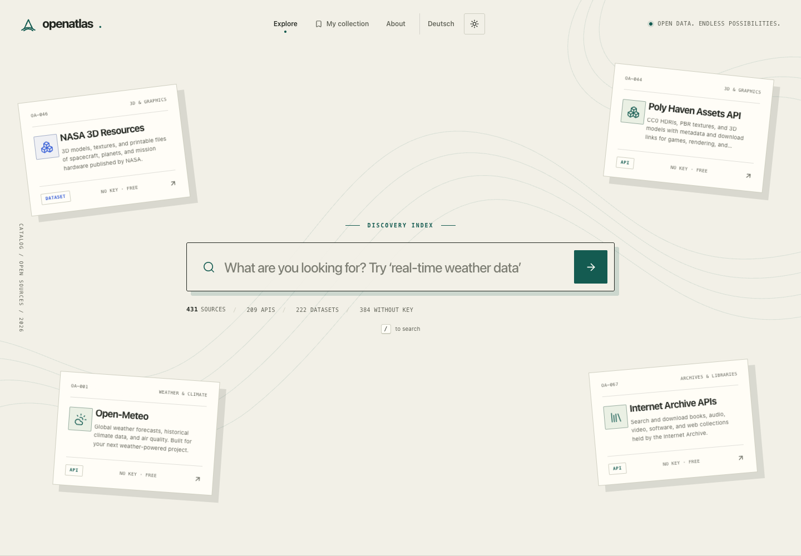

# OpenAtlas

**Free APIs & open data. Find your next possibility.**

[](https://michaels1011.github.io/openatlasmap/)
[](https://github.com/MichaelS1011/openatlasmap/actions/workflows/deploy-pages.yml)
[](LICENSE)

OpenAtlas is a curated catalog of free APIs, freemium APIs, and open datasets. Search real sources by name, subject, format, or use case, then check pricing, API-key requirements, and usage conditions before you build.



**[Open the live catalog](https://michaels1011.github.io/openatlasmap/)** · [Try a 3D search](https://michaels1011.github.io/openatlasmap/?q=3-D) · [View search results](docs/assets/openatlas-search.png)

## What it does

- Starts with one focused search field and real catalog cards in the background.
- Finds APIs, datasets, and archives, including normalized queries such as `3-D`, `3–D`, and `3D`.
- Filters by resource type, subject, API-key access, and fully free pricing.
- Provides a canonical, server-rendered page for every curated source.
- Keeps a session collection with JSON export.
- Offers English and German interfaces, light and dark themes, and reduced-motion support.
- Publishes the catalog as reusable MIT-licensed open data.

## Quick start

Requires Node.js 22 or newer.

```sh
git clone https://github.com/MichaelS1011/openatlasmap.git
cd openatlasmap
npm ci --legacy-peer-deps
npm run dev
```

Open the local URL printed by Vite.

## Verify a change

```sh
npm test
npx tsc --noEmit
PAGES_STATIC=1 npm run build
node scripts/prerender-pages.mjs
```

The production build refreshes `public/openatlas.json` and `public/llms-full.txt` from the catalog before rendering the site.

## Catalog and open data

`src/lib/resources.ts` is the single catalog source. The homepage, source pages, sitemap, search index, JSON export, and plain-text catalog all derive from it.

```sh
npm run export:catalog
```

- [`openatlas.json`](https://michaels1011.github.io/openatlasmap/openatlas.json) — machine-readable catalog.
- [`llms.txt`](https://michaels1011.github.io/openatlasmap/llms.txt) — citation and discovery guidance for AI assistants.
- [`llms-full.txt`](https://michaels1011.github.io/openatlasmap/llms-full.txt) — plain-text catalog for language-model context.
- [`sitemap.xml`](https://michaels1011.github.io/openatlasmap/sitemap.xml) — public static and source-detail routes.

Pricing, availability, and licenses can change. The original provider remains authoritative.

## Search, SEO, and generative discovery

Search state lives in the URL, while homepage canonicals stay clean. Public source pages are prerendered and include canonical links plus schema.org `Dataset` or `WebAPI` data. The site also publishes an `ItemList`, `WebSite`, `AboutPage`, `DataCatalog`, and `FAQPage` graph, bilingual hreflang links, a sitemap, robots rules, and an open plain-text catalog.

These features support conventional search, answer engines, and generative engine optimization without claiming control over third-party rankings or answers.

## Tech stack

- TanStack Start and TanStack Router
- React 19 and strict TypeScript
- Vite 8 and Tailwind CSS 4
- shadcn/ui with Radix primitives
- Vitest and Testing Library
- GitHub Pages with SSR followed by static prerendering

## Project structure

```text
src/
  components/       Atlas interface and shared UI
  lib/              Catalog, search state, i18n, SEO, sitemap
  routes/           Homepage, About, source details, sitemap
scripts/
  export-catalog.mjs
  prerender-pages.mjs
docs/assets/         Repository screenshots
```

## Contributing

Suggest a source through [GitHub Issues](https://github.com/MichaelS1011/openatlasmap/issues/new?title=Suggest%20a%20free%20API%20or%20dataset). Include the original provider URL, what it offers, pricing, access requirements, and a provider reference when available.

## License

[MIT](LICENSE) © Michael Soppa.
